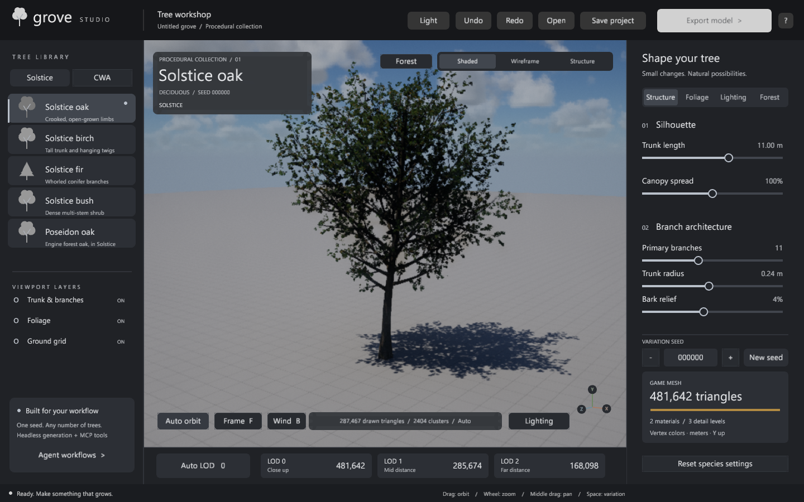
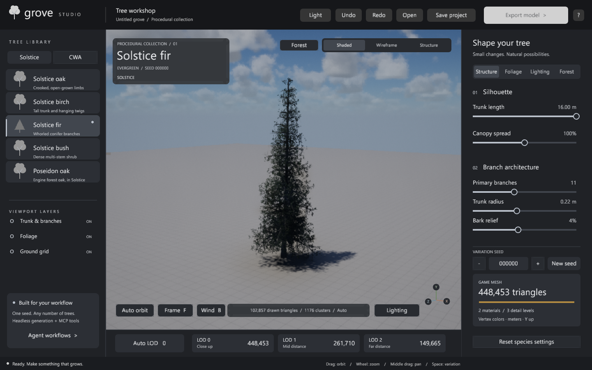

# Grove Studio

<div align="center">



A procedural tree workshop with a WebGPU preview. Edit, preview and export game-ready trees from the app, or use the same generator from the command line or an MCP client.

[](LICENSE)
[](https://www.rust-lang.org/)
[](https://github.com/sponsors/koosoli)
[](https://buymeacoffee.com/koosolicontinuecontinue)

</div>

---

## Support the project

Grove Studio is free and open source. If it saves you time, you can support its development:

<div align="center">

[](https://github.com/sponsors/koosoli)
&nbsp;
[](https://buymeacoffee.com/koosolicontinuecontinue)

</div>

---

## Features

- **Tree library**: Solstice trees and shrubs, including the garden weeping willow and old oak, plus Poseidon-style and CWA-inspired presets.
- **Live WebGPU preview** using Solstice's cluster hierarchy, occlusion culling, cascaded shadows and voxel/screen-space global illumination.
- **Structure and foliage controls** including trunk straightness, branch angle and droop, with immediate updates, plus LOD inspection (Auto LOD or explicit LOD 0-2) that reports drawn triangles and clusters.
- **Seasons**: summer, autumn, spring and winter palettes. Winter drops almost all leaves and keeps the wood.
- **Forest and lighting**: a woodland scene with per-species weights, solar time, sun azimuth and six skyboxes.
- **Bark relief** with parallax occlusion in the preview and a normal map plus height map in exports.
- **Export** to glTF 2.0 (with LODs and wind attributes), Wavefront OBJ (with bark textures), and native Poseidon P3D.
- **Projects** that store every setting, including the seed, with 60 levels of undo/redo.
- **Headless CLI and MCP server** for batch generation, scripting and AI-agent workflows. No window or GPU is required for mesh export.
- **Light and dark themes**.

## Trees

| Preset | Notes |
|---|---|
| `solstice-oak` | Crooked, open-grown limbs |
| `solstice-birch` | Tall trunk and hanging twigs |
| `solstice-fir` | Whorled conifer branches, evergreen |
| `solstice-bush` | Dense multi-stem shrub |
| `solstice-willow` | Weeping willow with long hanging shoots |
| `solstice-old_oak` | Broad old oak specimen |
| `solstice-poseidon-oak` | Forest oak proportions re-expressed in Solstice's format (see [CREDITS.md](CREDITS.md)) |

<div align="center">



</div>

## Installation

### Prebuilt executable

Download `grove-studio.exe` from the [Releases](https://github.com/koosoli/grove-studio/releases) page and double-click it. Keep it in any folder; it creates `exports/` relative to where you run it.

### Build from source

Requirements:

- A recent stable Rust toolchain (`rustup` recommended)
- A GPU and driver that support WebGPU (DirectX 12 or Vulkan on Windows) for the preview
- Git, because Solstice is pulled from GitHub at a pinned revision

```text
cargo build --release
cargo run --release
```

The executable is `target/release/grove-studio.exe` on Windows. `--classic` starts the OpenGL fallback without the Solstice renderer.

The project was developed and tested on Windows. The code is portable Rust, but other platforms are untested.

## Using the editor

1. Pick a species in the library. Each preset loads with its own proportions and bark.
2. Adjust **Structure** (height, spread, branches, trunk radius, bark relief) or **Foliage** (density, leaf size, season). Each edit updates the preview.
3. Orbit by dragging, zoom with the wheel (each notch changes the distance by about 5 %), pan with middle-drag, and press **F** to frame the tree.
4. Use **Auto LOD** for screen-space detail, or pick **LOD 0-2** to inspect the export meshes.
5. Open **Forest** to toggle species and set their weights (0 to 10).
6. Open **Lighting** to set solar time and sun azimuth (clockwise from scene north, −Z), and to choose a skybox: Clear, Fair, Broken, Overcast, Storm or Cirrus. Dawn, Noon, Dusk and Night set the time at once.
7. Save a project, or export glTF, OBJ or Poseidon P3D.

| Key | Action |
|---|---|
| Ctrl+S / Ctrl+O | Save / open project |
| Ctrl+Z / Ctrl+Y | Undo / redo |
| Space | Generate a new variation |
| G / W / B | Toggle grid / wireframe / wind |
| 0, 1, 2, 3 | Auto LOD, then LOD 0, 1, 2 |
| F | Frame the tree |
| F1 | Keyboard help |

Projects saved with the earlier `oak`, `birch` or `pine` species open as `solstice-oak`, `solstice-birch` and `solstice-fir`.

## Export and game import

- **Units and axes**: meters, Y up. Each tree has separate Bark and Foliage materials, with vertex colors, normals, UVs and glTF tangent frames.
- **glTF 2.0**: a `.gltf` and `.bin` pair per LOD, with textures embedded in the binary buffer. Foliage is opaque and double-sided. Keep the `.bin` beside the `.gltf`.
- **OBJ**: `.obj`, `.mtl` and bark color, normal and height PNGs. Vertex RGB is included as an extension. Keep all sidecars together. Configure foliage to render both sides.
- **LODs**: LOD 0 is the full tree. LOD 1 keeps alternate leaves, and LOD 2 keeps one in five, growing the remaining pieces. All LODs share the same ground origin.
- **Game LOD ladder** (`--lod game`, Poseidon P3D): four visual levels target at most 150,000, 30,000, 6,500 and 1,500 exported P3D faces (including reversed foliage faces). Near uses opaque individual leaf geometry; mid and distant levels use alpha cards or clustered sprays. Thinned pieces grow to compensate for lost geometric leaf area. Sparse trees can be below these targets. The exported shadow-buffer LOD is capped separately and a coarse `_occlusion.p3d` is provided for explicit use. The checked-out engine shadow pass selects visual LODs for visible objects and does not automatically consume this shadow level or occlusion sidecar; runtime support must be verified or added on the engine side.
- **Card trimming:** mid and distant game cards are trimmed by default. Clipping can add triangles, so whole cards are thinned to fit the final budget and enlarged to preserve their combined geometric area. Alpha coverage, overlapping leaves, compressed mips and filtering can change the visible coverage; profile and inspect in the target engine. Use `--no-trim-cards` or MCP `trimCards: false` to compare.
- **FOREST-PROXY tree models** (`--lod game --forest-proxy`): the per-tree properties expected by compatible forest-instancing builds: `facepairs` (every leaf face has its reverse twin), `forestcrowns` (per-crown radial leaf normals) and `forestinterior` on every level, and `lodfade`, `barkpom` and `shadowcoarser` on the nearest. Origin is the trunk foot with `autocenter=0`; the block itself (the empty proxy level and the `voxsource` union of each tree's coarsest level) is written by `PoseidonTools tree forest-block --proxy-trees --tree <this.p3d>=<weight>`.
- **Wind**: glTF includes a `_WIND` custom attribute with normalized height squared and a foliage flutter weight. Poseidon P3D uses the existing height-based tree sway; its alpha foliage shares one flutter phase per tree. The Solstice preview instead adds a continuous local branch-sway approximation and tip-weighted individual leaf flutter, so this fine motion is preview-only and is not reproduced by Poseidon. Baked spray cards receive only shared sway. These are artistic approximations, not a physical wind simulation; exports contain no baked animation.
- **Parallax**: the Bark material includes a standard `normalTexture`, plus `extras.parallax` with the height texture index, UV scale, 16 layers and height convention (white is raised). Core glTF has no parallax property, so ordinary importers show the normal-mapped bark only.
- **Triangle counts** are measured from the real mesh. Faces with no area are removed during generation.

Geometry is separate branch shells, not a welded watertight trunk. Collision meshes, texture atlases, billboards and automatic engine import are outside this version.

### Poseidon

```text
grove-studio --headless --preset solstice-poseidon-oak --out exports/poseidon-oak/oak.p3d --lod all
PoseidonTools pbo pack exports/poseidon-oak exports/oak.pbo --prefix grove_oak
PoseidonTools model inspect exports/poseidon-oak/oak.p3d
```

Pack each export directory using the `pboPrefix` in its manifest. The native bundle includes visual and trunk collision LODs, PAA textures, RVMAT materials and relief metadata. `PoseidonTools` is a separate third-party tool and is not included.

## Seasons

Foliage > Season palette includes Winter. Oak, birch and bush keep about 1/29 of their leaves; fir keeps its needles with a colder tint. Switching seasons preserves all wood positions, so a bare winter tree may be slightly shorter than its summer canopy.

```text
grove-studio --headless --preset solstice-oak --season winter --parallax-depth 0.04 --out exports/winter.gltf
```

## Headless generation

These commands create no window or graphics context. Successful results are printed as JSON on stdout; errors go to stderr with a nonzero exit code.

```text
grove-studio --headless --preset solstice-oak --seed 42 --out exports/oak.gltf --lod all
grove-studio --headless --preset solstice-fir --count 12 --out exports/fir.obj --format obj
grove-studio --headless --config exports/project.json --out exports/custom.gltf
grove-studio --headless --preset solstice-birch --inspect
grove-studio --help
```

Options include `--seed`, `--height`, `--density 0.25..1.8`, `--season`, `--parallax-depth 0..0.08`, `--format gltf|obj|p3d`, `--lod 0|1|2|all` and `--count 1..100`. Batch generation increments the seed for each tree.

The GPU preview can also render to a PNG without a window:

```text
grove-studio --headless --preview --forest solstice-oak,solstice-birch,solstice-fir,solstice-bush,solstice-poseidon-oak --time-of-day 18.5 --sun-azimuth 260 --skybox broken --out exports/woodland.png
grove-studio --headless --preview --preset solstice-fir --preview-view clusters --distance 65 --out exports/fir-clusters.png
```

Preview options include `--forest`, `--skybox`, `--wind-time` (seconds), `--lod auto|0|1|2|3` (game preview), and diagnostic views `clusters`, `triangles`, `gi`, `reflections`, `voxels`, `albedo` and `normals`. The Weather tab controls cloud cover, wind speed, direction, strength, branch sway and springiness, gusts and leaf flutter. The Render tab controls leaf specular, roughness and translucency. MCP `tree_preview` accepts `cloudCover`, `windStrength`, `windGust`, `branchSway`, `branchSpringiness`, `leafFlutter`, `leafSpecular`, `leafRoughness` and `leafTransmission`; CLI preview provides matching options. Springiness adjusts the lag and resonance of the preview branch response; stopping wind fades the motion rather than snapping it off. This is an approximation, not a full physical spring simulation. These are viewer settings, not exported material settings.

The viewport's **Structure** button hides the foliage while keeping the live wind renderer. For a headless version use `--preview --structure`; MCP `tree_preview` accepts `"structure": true`. Wind rotates branches around generated attachment points, with simplified LODs using approximate ownership when pieces are combined.

Use `grove-studio --budget-report` to print JSON counts for the seven forest presets, or add `--preset NAME` for one species. Geometry byte counts describe in-memory vertices and indices, not GPU allocations or textures. `two_sided_faces` counts P3D front and reverse foliage faces; `foliage_geometry_area_m2` is unmasked triangle area, not visible alpha coverage. The same per-tree report is available through MCP `tree_budget_report`.

Search the tree library by name or model ID. In **Shape**, Tree age is a relative maturity scale, not years: 100% is the mature preset, with saplings down to 15% (40% for the bush preset). Young trees grow shorter, slimmer branches while retaining leaf size; mixed forests use separately grown young trees. **Random tree** varies the current species' seed, shape and foliage; **Random shape**, **Random leaves** and the small **R** buttons vary only the indicated controls. Season and imported materials stay as selected unless changed separately. Undo restores previous settings. For repeatable results, the CLI accepts `--randomize all|shape|foliage --random-seed N` or `--random-field NAME --random-seed N`. MCP provides `tree_randomize` with `scope` or `field`; `tree_presets` also accepts an optional `query`.

The Render tab can load PNG bark color, height and normal maps, plus a four-column leaf color atlas. Project files refer to these images by path. Game LOD P3D exports also write a `_wind.json` hierarchy sidecar; Poseidon requires separate engine support to read and animate it, and its legacy wind remains the fallback.

## MCP

Configure an MCP client to start the executable with `--mcp`. The server speaks newline-delimited JSON-RPC 2.0 over stdin/stdout and writes no logs to stdout.

```json
{
  "mcpServers": {
    "grove": {
      "command": "C:/path/to/grove-studio.exe",
      "args": ["--mcp", "--output-root", "C:/path/to/tree-exports"]
    }
  }
}
```

`--output-root` defaults to `exports`. Outputs must stay inside it: parent traversal, absolute paths and symlinks that escape the root are rejected.

| Tool | Input | Result |
|---|---|---|
| `tree_presets` | `{}` | Default settings for each species |
| `tree_inspect` | `{"settings":{"species":"solstice-oak","seed":42}}` | Bounds, vertices, triangles and material counts for all LODs |
| `tree_generate` | `{"settings":{"species":"solstice-oak","seed":42},"output":"oak.gltf","format":"gltf","lod":"all"}` | Model paths and measured geometry statistics |
| `tree_preview` | `{"output":"forest.png","forest":"solstice-oak,solstice-fir","timeOfDay":18.5,"sunAzimuth":260,"skybox":"overcast"}` | PNG path and measured visible triangles and clusters |

Settings accept `species`, `seed`, `height`, `spread`, `branches`, `density`, `leaf_size`, `trunk_radius`, `season` (0 summer, 1 autumn, 2 spring, 3 winter) and `parallax_depth` (0 to 0.08). Omitted settings use each species' defaults. Tool errors are reported with `isError: true`.

## Testing

```text
cargo test --release
grove-studio --screenshot shots/now.png
grove-studio --self-test shots/self-test.json
python verify.py
```

`verify.py` runs headless batches and checks glTF buffers and materials, native P3D sidecars, OBJ topology and the MCP protocol. Set `GROVE_VERIFY_OUT` to choose where it writes its outputs. It needs Python with Pillow.

## Credits and license

Grove Studio is licensed under the **GNU General Public License v3.0 or later**. See [LICENSE](LICENSE).

- Trees, the renderer and the procedural bark and leaf textures come from [Solstice](https://github.com/SamG-Coder/solstice) by SamG-Coder (MIT); the weeping willow and old oak also feature in [Solstice Garden](https://github.com/SamG-Coder/solstice-garden) (MIT). A modified copy of its renderer is in `vendor/solstice-render`, with its [MIT license](vendor/solstice-render/LICENSE).
- The Poseidon oak re-expresses the forest oak preset of the Poseidon engine, which uses the ez-tree growth model by Dan Greenheck (MIT). See [CREDITS.md](CREDITS.md).
- Third-party Rust dependency licenses are listed in [THIRD-PARTY-NOTICES.txt](THIRD-PARTY-NOTICES.txt).
- The editor loads Segoe UI from your own Windows installation if present, and falls back to the built-in font otherwise. No font files are redistributed.
